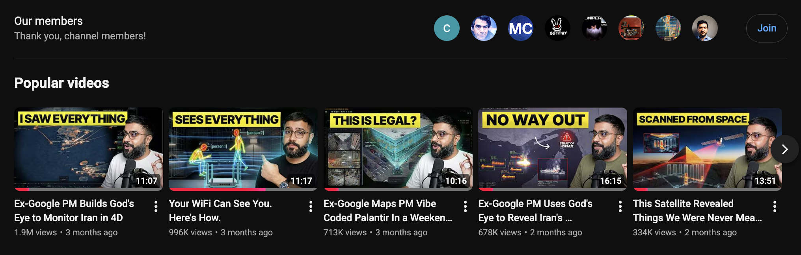

<div align="center" dir="rtl">

# 🌐 أودين (Odin)

[](https://github.com/bilawalsidhu/gods-eye-view/actions/workflows/ci.yml) [](https://x.com/bilawalsidhu/status/2093798887815348521)

**[English](README.md)** · **[Français](README.fr.md)** · **[Русский](README.ru.md)** · **[简体中文](README.zh-CN.md)** · **[日本語](README.ja.md)** · **[العربية](README.ar.md)**

> [!NOTE]
> **توثيق متعدد اللغات:** تم إعداد هذه النسخة العربية لتسهيل وصول المجتمع العربي. المرجع التقني الرسمي المعتمد هو [ملف README الأصلي باللغة الإنجليزية](README.md). نرحب بمساهمات المجتمع في التدقيق اللغوي عبر طلبات السحب (Pull Requests).

> [!IMPORTANT]
> **أودين (Odin)** هو تفريع برمجي (Fork) سيادي مستقل للمشروع مفتوح المصدر [God's Eye View](https://github.com/bilawalsidhu/gods-eye-view)، الذي أنشأه في الأصل [بيلاوال سيدهو](https://github.com/bilawalsidhu) و[سامح خميس](https://github.com/samehkhamis) في [Halfpixel](https://halfpixel.ai).
> تتولى صيانته وتطويره ونشره مؤسسة **[Seclib](https://github.com/seclib)** بموجب رخصة MIT. للاطلاع على الإسناد الكامل وقائمة التعديلات ورخص بيانات الأطراف الثالثة، راجع [NOTICE.md](NOTICE.md).

### منصة استخبارات مكانية جغرافية تفاعلية في متصفحك — إشارات عامة، قياسات حقيقية، وبنية سيادية.

كرة أرضية واقعية ثلاثية الأبعاد. تتبع مباشر لحركة الطيران والملاحة البحرية والأقمار الصناعية والزلازل والحركة المرورية وكاميرات المراقبة العامة. تحكم صوتي دون استخدام اليدين وتوليد ملخصات استخباراتية مدعومة بنماذج ذكاء اصطناعي سيادية محلية أو سحابية.

_لا نترك بقعة في العالم دون رصد._


<a href="https://www.youtube.com/@bilawalsidhu">
  
</a>

▶️ **من مطوري المشروع صاحب السلسلة الشهيرة عالمياً** _(المعروفة سابقاً باسم WorldView)_ — [أكثر من 5 ملايين مشاهدة على يوتيوب](https://youtube.com/playlist?list=PL6qSg2I-7_koPbDnSMo0QeeHX_RknA2uv&si=nBGYMoHWQw41v93Q) · [أكثر من 25 مليون تفاعل](https://www.google.com/search?q=god%27s+eye+view) · 🏆 **المركز الأول على GitHub Trending**

⚡ **ابدأ العمل فوراً دون مفاتيح API.** يعمل محلياً بالكامل عبر Docker Compose أو Node.js. 18 طبقة من أصل 20 طبقة تعمل مجاناً وبدون أي مفتاح. **[← البدء السريع](#-البدء-السريع)**

</div>

---

<div align="center" dir="rtl">

**[البدء السريع](#-البدء-السريع) · [الأصل والتعديلات](#-الأصل-والتعديلات-التي-أدخلتها-seclib) · [القدرات والحدود التقنية](#-القدرات-الحقيقية-والحدود-التقنية) · [الطبقات المتاحة](#-ما-الذي-يظهر-على-الكرة-الأرضية) · [الذكاء الاصطناعي](#-قدرات-الذكاء-الاصطناعي-ethan-المحلي-والنماذج-السحابية) · [الأمان والخصوصية](#-الخصوصية-ونموذج-الأمان-والاتصالات-الشبكية) · [الرخص](NOTICE.md) · [المساهمة](CONTRIBUTING.md)**

</div>

---

<div dir="rtl">

## 🏛️ الأصل والتعديلات التي أدخلتها Seclib

مشروع Odin هو تفريع برمجي مستقل ومحافظ عليه لمشروع **God's Eye View** مفتوح المصدر للمطورين بيلاوال سيدهو وسامح خميس (Halfpixel).

### لماذا تم إنشاء هذا التفريع؟

أثبت المشروع الأصلي إمكانية دمج الإشارات الجيومكانية المفتوحة (بيانات ADS-B للطيران، ونظام AIS للسفن، ونماذج SGP4 للأقمار الصناعية، ومقاييس الزلازل، وكاميرات المراقبة، ورادارات الطقس) في بيئة كروية تفاعلية واحدة.

قامت **Seclib** بإنشاء تفريع **Odin** لملاءمة هذه البنية مع متطلبات السيادة الرقمية، والأمان العالي، وحماية الخصوصية الصارمة:
- **سيادة الذكاء الاصطناعي المحلي:** فك الارتباط بنماذج الذكاء الاصطناعي السحابية المغلقة وتشغيل وظائف التحليل والاستخبارات محلياً بنسبة 100% عبر منصة **ETHAN**.
- **العزل الأمني بالحاويات:** حصر الاستماع الشبكي الصارم على الواجهة المحلية (Loopback) وتشديد معايير الخوادم الوسيطة (Proxies).
- **إتاحة عالمية متعددة اللغات:** توفير ترجمات أصلية متكاملة بست لغات رئيسية، ودعم حقيقي كامل للكتابة من اليمين إلى اليسار (RTL) مع مرآة بصرية لكافة القوائم وعناصر التحكم للغة العربية.
- **وضوح الحدود القانونية للبيانات:** الفصل التام بين كود المشروع الخاضع لرخصة MIT ومجموعات البيانات التابعة لجهات خارجية والمقيدة برخص غير تجارية.

### التعديلات التي أجرتها Seclib

تحافظ كافة التعديلات على التوافق الخلفي مع تنسيقات مشاهد God's Eye View:

1. **الهوية والعلامة التجارية:** تم إطلاق اسم **Odin** تحت مظلة منظمة Seclib، مع حفظ حقوق التأليف الأصلية كاملة في [NOTICE.md](NOTICE.md).
2. **التكامل السيادي مع منصة ETHAN:**
   - اتصال أصيل بنماذج منصة ETHAN المحلية عبر المتغيرين `GEV_ETHAN_API_URL` و `GEV_ETHAN_API_KEY`/`GEV_ETHAN_TOKEN`.
   - توليد ملخصات لوحة التحكم التكتيكية (HUD) محلياً دون إرسال أي إحداثيات أو بيانات إلى السحابة.
3. **أمان بيئة Docker والشبكة:**
   - تقييد ملف `compose.yaml` بالاستماع الصارم على `127.0.0.1:4173`، لمنع تسريب المفاتيح عبر الشبكة المحلية (LAN).
   - التحقق الصارم من ترويسة HTTP Host عبر `GEV_ALLOWED_HOSTS` للحماية من هجمات DNS Rebinding.
   - تعطيل الأنفاق غير الآمنة والوسطاء غير الموثوقين افتراضياً.
4. **بنية تدويل متقدمة (i18n):**
   - قواميس ترجمة معتمدة بالكامل للغات: **الإنجليزية** (`en`)، **الفرنسية** (`fr`)، **الروسية** (`ru`)، **الإسبانية** (`es`)، **الصينية المبسطة** (`zh-CN`)، **اليابانية** (`ja`)، و**العربية** (`ar`).
   - محرك عرض مرآتي كامل للواجهة للغة العربية (محاذاة العناصر، عزل القوائم، وانعكاس الأيقونات).
5. **التدقيق القانوني والحوكمة:**
   - توثيق البيانات المحكومة بشروط غير تجارية (NC) مثل كابلات TeleGeography وبيانات فيضان Bhote Koshi.
   - وضع سياسة واضحة ومسؤولة للإبلاغ عن الثغرات الأمنية في [SECURITY.md](SECURITY.md).

---

## ⚠️ القدرات الحقيقية والحدود التقنية

يجمع Odin تدفقات البيانات العامة لمنح وعي ميداني متكامل، ومن الضروري التمييز بدقة بين الإشارات الحية، والنماذج الرياضية، والمحاكاة:

| فئة الإشارة | الطبقات التابعة | طبيعة البيانات والواقع التشغيلي |
| :--- | :--- | :--- |
| **رصد حي مباشر** | رحلات الطيران المدني والعسكري، السفن (AIS)، الزلازل (USGS) | إشارات حقيقية من أجهزة الإرسال؛ تُحدّث كل 15–30 ثانية؛ استيفاء خطي بين النقاط. |
| **نماذج استكمال رياضية** | الأقمار الصناعية المدارية، سرعة واتجاه الرياح والطقس (GFS/ECMWF) | حساب مداري بنموذج SGP4 استناداً لعناصر CelesTrak؛ ورادار nowCOAST المدمج؛ ونماذج GFS العددية. |
| **تقديرات وإعادة بناء** | إطلاق الصواريخ (Falcon 9)، مخاريط رؤية كاميرات المراقبة (Viewsheds) | مصنفة كـ RECONSTRUCTED ESTIMATE: مسارات إطلاق تقديرية وليست راداراً مباشراً. توجيه الكاميرات تقديري ويُعاير يدوياً. |
| **محاكاة تخليقية** | حركة المرور في الشوارع | حركة سيارات افتراضية على شبكة طرق OpenStreetMap؛ سرعة التدفق محكومة ببيانات TomTom. النقاط لا تمثل سيارات حقيقية بعينها. |
| **مؤشرات اضطراب** | سلامة إشارات الملاحة (GNSS) | درجات مجمعة من دقة ملاحة الطائرات؛ انخفاض الدرجة يشير لتشوه الإشارة ولا يُعد دليلاً قاطعاً على تشويش متعمد. |

> [!IMPORTANT]
> **إخلاء مسؤولية تشغيلي:** Odin هو منصة استكشافية للمراقبة والتحليل البصري. قد تتضمن البيانات تأخيراً أو نقصاً أو أخطاء حسابية.
> **يُحظر تماماً** استخدام Odin في الملاحة الجوية أو البحرية، أو إدارة عمليات الطوارئ، أو العمليات العسكرية، أو التدخلات الطبية، أو أي تطبيقات حرجة ترتبط بسلامة الأرواح. يجب دائماً العودة إلى المصادر الرسمية المعتمدة.

---

## ⚡ البدء السريع

يمكنك تشغيل Odin فوراً **دون تسجيل حساب ودون أي مفاتيح API**. تُعرض الخريطة افتراضياً عبر صور Esri الفضائية وتضاريس مجانية.

### الطريقة 1 — تشغيل Node.js محلياً (المفضلة للمطورين)

المتطلبات: **Node.js 24 LTS (الإصدار 24.14.0 فما فوق) أو الإصدار 26.x**.

```bash
# 1. استنساخ المستودع
git clone https://github.com/seclib/odin.git
cd odin

# 2. تثبيت الحزم المقفلة
npm ci

# 3. فحص جاهزية البيئة
npm run doctor

# 4. تشغيل خادم التطوير المحلي
npm run dev
```

افتح المتصفح على: **`http://localhost:4173`**.

### الطريقة 2 — تشغيل Docker Compose (المفضلة للإنتاج والعزل الأمني)

المتطلبات: تثبيت Docker Engine و Docker Compose. لا يلزم تثبيت Node.js على جهازك.

```bash
# 1. استنساخ المستودع
git clone https://github.com/seclib/odin.git
cd odin

# 2. التشغيل مع الحفاظ على صلاحيات المستخدم
env UID=$(id -u) GID=$(id -g) docker compose up
```

افتح الرابط **`http://localhost:4173`**.
- تظل ملفات الإعدادات والذاكرة المؤقتة (`.env` و `.gev-cache/` و `.gev-logs/`) محفوظة في مجلدك على الجهاز المضيف.
- يرتبط المنفذ حصرياً بالعنوان `127.0.0.1:4173` لمنع وصول أي مستخدمين عبر الشبكة المحلية.

---

## 🛠️ الإعدادات واستكشاف الأخطاء

### الإعداد من واجهة المستخدم (Provider Settings)

انقر على زر **POWER UP** في الزاوية السفلية من الواجهة (أو توجه إلى `http://localhost:4173/?setup=1`). يتيح لك هذا القسم إضافة المفاتيح الاختيارية بأمان لتُحفظ في ملف `.env` المحلي.

### متغيرات البيئة (`.env`)

للإعداد السريع عبر الخوادم، انسخ ملف النموذج:

```bash
cp .env.example .env
```

أهم المتغيرات:
- `PORT=4173` — منفذ خادم الويب.
- `HOST=127.0.0.1` — عنوان الاستماع (استخدم `0.0.0.0` فقط عند الرغبة بالمشاركة عبر LAN).
- `GEV_ALLOWED_HOSTS=localhost,127.0.0.1` — عناوين Host المسموح بها للحماية من هجمات DNS Rebinding.
- `GEV_ETHAN_API_URL=http://localhost:8000` — عنوان منصة ETHAN المحلية.
- `GEV_ETHAN_API_KEY=` — مفتاح أو رمز التوثيق لمنصة ETHAN.
- `OPENAI_API_KEY=` — مفتاح اختياري لخدمات الصوت السحابية من OpenAI.
- `CESIUM_ION_TOKEN=` — رمز Cesium ion المجاني للمباني ثلاثية الأبعاد والتضاريس العالمية.
- `GOOGLE_MAPS_API_KEY=` — مفتاح Google Maps للبلاطات ثلاثية الأبعاد والتجول الافتراضي.
- `AISSTREAM_API_KEY=` — مفتاح مجاني لتتبع السفن في جميع أنحاء العالم.

### استكشاف الأخطاء الشائعة

1. **خطأ صلاحيات في Docker (`EACCES` على ملف `.env` أو `.gev-cache`) :**
   - السبب: تشغيل الحاوية بصلاحيات `root`.
   - الحل: شغل الأمر مع تحديد المعرفات: `env UID=$(id -u) GID=$(id -g) docker compose up`.
2. **بطء وتقطع في حركة الكرة الأرضية :**
   - السبب: تسريع العتاد (Hardware Acceleration) معطل في المتصفح أو عمل WebGL عبر المعالج (CPU Software Rendering).
   - الحل: فعل تسريع العتاد من إعدادات المتصفح، وتأكد من الصفحة `chrome://gpu`.
3. **نافذة الإعدادات ترفض الحفظ وتظهر «Loopback Only» :**
   - السبب: الدخول عبر عنوان IP خارجي أو خادم وسيط غير مصرح له.
   - الحل: عدّل ملف `.env` مباشرة في الجهاز المضيف أو اضبط المتغير `GEV_KEY_SETUP_TRUSTED_PEERS` وفقاً لدليل [SECURITY.md](SECURITY.md).
4. **طبقة المرور أو الكاميرات خالية من البيانات :**
   - السبب: قيود المعدل من خوادم Overpass التابعة لـ OpenStreetMap. يقوم الخادم الوسيط الداخلي بتخزين البيانات مؤقتاً؛ أعد التشغيل بالأمر `npm run dev`.

---

## 🛰️ ما الذي يظهر على الكرة الأرضية؟

عشرون طبقة استخباراتية في واجهة واحدة. **ثماني عشرة طبقة تعمل بالكامل دون الحاجة لأي مفاتيح.**

| الطبقة | البيانات المعروضة والوظائف | مزود البيانات | متطلبات التوثيق |
| :--- | :--- | :--- | :--- |
| 🗺️ **خرائط وتضاريس** | صور أقمار Esri، وبلاطات Google 3D، و OpenStreetMap | Esri / Google / Cesium ion / OSM | 🟢 Esri و OSM مجاناً<br>🟡 Ion Google 3D تسجيل مجاني<br>🔴 Google 3D دفع حسب الاستهلاك |
| ✈️ **طيران مباشر** | أكثر من 11,000 طائرة مدنية مع مساراتها التاريخية | OpenSky Network و adsb.lol | 🟢 بدون مفتاح (🟡 حساب OpenSky اختياري) |
| 🎖️ **طيران عسكري** | طائرات عسكرية وطائرات تزويد بالوقود ونداءات طوارئ | adsb.lol (بث ADS-B مصفى) | 🟢 بدون مفتاح |
| 📡 **سلامة الملاحة GNSS** | تقييم دقة إشارات الملاحة ورصد مناطق التشويش | adsb.lol و GPSJAM | 🟢 بدون مفتاح |
| 🚢 **سفن حية** | تتبع الملاحة البحرية حول العالم (شحن، ناقلات، ركاب) | AISStream.io | 🟡 تسجيل مجاني للحصول على مفتاح |
| 🛰️ **أقمار صناعية** | أكثر من 830 قمراً بمدارات SGP4 (بما في ذلك Starlink) | CelesTrak | 🟢 بدون مفتاح |
| 🌍 **زلازل العالم** | النشاط الزلزالي العالمي خلال آخر 24 ساعة | هيئة المسح الجيولوجي الأمريكية (USGS) | 🟢 بدون مفتاح |
| 🔥 **حرائق نشطة** | رصد النقاط الحرارية حول العالم عبر MODIS و VIIRS | NASA FIRMS | 🟡 تسجيل مجاني للحصول على مفتاح |
| 📹 **شبكة كاميرات CCTV** | أكثر من 4,000 كاميرا مراقبة عامة مدمجة في المدن 3D | وكالات النقل في تكساس وكاليفورنيا ولندن وغيرها | 🟢 بدون مفتاح |
| 🚗 **حركة المرور** | محاكاة حركة السيارات على شبكات طرق OpenStreetMap | OpenStreetMap + TomTom Flow | 🟢 محاكاة أساسية<br>🟡 سرعات حية من TomTom |
| 📷 **صور الشوارع** | صور بانورامية للشوارع مع مخاريط اتجاه الرؤية | Mapillary, Google, KartaView, Panoramax | 🟢 KartaView و Panoramax<br>🟡 Mapillary<br>🔴 Google |
| 📻 **إذاعات العالم** | أكثر من 750 محطة إذاعية جغرافية مع مؤشر تناظري | Radio Browser | 🟢 بدون مفتاح |
| 🚌 **النقل العام** | حافلات وقطارات وترام وعبّارات مباشرة مع مساراتها | تدفقات GTFS-Realtime المفتوحة | 🟢 بدون مفتاح |
| 🚲 **دراجات مشتركة** | مواقع المحطات وعدد الدراجات المتاحة فورياً | بيانات GBFS المفتوحة | 🟢 بدون مفتاح |
| 🧭 **توجيه ومسارات** | مسارات قيادة ودراجات ومشي مع تحليق كاميرا افتراضية | OSRM / FOSSGIS | 🟢 بدون مفتاح |
| 🚀 **رحلات الفضاء** | عمليات إطلاق الصواريخ خلال 30 يوماً مع محاكاة المسار | Launch Library 2 | 🟢 بدون مفتاح (🟡 رمز اختياري لرفع الحصة) |
| 🎖️ **مواقع عسكرية** | سياق المواقع العسكرية ومحطات الرادار المجتمعية | OpenStreetMap | 🟢 بدون مفتاح |
| 🌬️ **متجهات الرياح** | جزيئات رياح متحركة على ارتفاع 10 أمتار (سرعة، حرارة، ضغط)| NOAA GFS / ECMWF IFS | 🟢 بدون مفتاح |
| 🌦️ **رادار الطقس** | رادار الأمطار، وصور السحب بالأشعة تحت الحمراء، والبرق | NOAA nowCOAST | 🟢 بدون مفتاح |
| 🌀 **الأعاصير المدارية**| مواقع التحذيرات ومسارات الأعاصير المتوقعة | NOAA NHC / CPHC | 🟢 بدون مفتاح |

_دليل الرموز:_ 🟢 **يعمل دون أي مفتاح** · 🟡 **تسجيل مجاني للحصول على مفتاح** · 🔴 **خدمة مدفوعة حسب الاستهلاك**

---

## 🤖 قدرات الذكاء الاصطناعي: ETHAN المحلي والنماذج السحابية

يوفر Odin تحليلاً استخباراتياً للمشهد، وإجابات عن الكيانات الجغرافية، وتحكماً صوتياً متكاملاً.

### 1. الذكاء السيادي المحلي عبر ETHAN (إضافة Seclib)

للبيئات الحساسة والشبكات المعزولة، يتكامل Odin أصلياً مع **ETHAN** :
- يستعلم الملخص التكتيكي في لوحة HUD خادم ETHAN المحلي مباشرة (`GEV_ETHAN_API_URL=http://localhost:8000`).
- يتم تجميع حدود المشهد الحالي والارتفاع والطبقات النشطة والأهداف العسكرية القريبة في إيجاز استخباراتي ومعالجته محلياً.
- **عدم خروج أي بيانات إطلاقاً:** لا يتم إرسال أي أوامر أو إحداثيات أو صور خارج بنيتك التحتية.

### 2. التحكم الصوتي السحابي (OpenAI)

- يعتمد على **OpenAI Realtime API** عبر WebSocket لتقليل زمن الاستجابة الصوتية.
- **سقف مالي حاسم:** حد أقصى للإنفاق **5.00 دولارات** للجلسة مع تنبيه عند 2.00 دولار ومؤشر حي للمصروفات.
- يتيح تنفيذ 30 أداة تشغيلية بالصوت:
  - _الملاحة:_ «انتقل بي إلى طوكيو»، «قم بالدوران ببطء حول الميناء».
  - _التدوين:_ «حدد حدود ولاية تكساس»، «احسب المسافة بين باريس والرياض».
  - _التحليل:_ «كم عدد ناقلات النفط في مضيق هرمز؟»، «اعرض الطائرات العسكرية فوق 30 ألف قدم».
  - _التحكم:_ «بدل إلى الرؤية الحرارية FLIR»، «ادخل إلى قمرة قيادة أقرب طائرة».

### 3. خادم بروتوكول سياق النموذج (MCP)

يعمل Odin كخادم أدوات MCP قياسي، مما يتيح للعملاء البرمجيين (مثل Claude Desktop و Codex و ChatGPT) فحص الكرة الأرضية والتحكم بها برمجياً. انظر [docs/MCP_SETUP.md](docs/MCP_SETUP.md).

---

## 🔒 الخصوصية، نموذج الأمان، والاتصالات الشبكية

صُمم نظام Odin وفق مبادئ الدفاع الأمني المتعدد:

### 1. العمل المحلي أولاً دون أي تعقب
- **لا يحتوي Odin على أي برمجيات تتبع أو ملفات قياس أداء أو إحصاءات استخدام**.
- لا يتم إرسال أي تقارير استخدام أو تشخيص إلى Seclib أو مطوري المشروع الأصلي.
- يعمل التطبيق محلياً في متصفحك ولا يتصل إلا بخادمك المحلي ومزودي البيانات المفعلين اختيارياً.

### 2. عزل المفاتيح السرية في جانب الخادم
المفاتيح الخاصة ذات الصلاحيات العالية (`OPENAI_API_KEY` و `AISSTREAM_API_KEY` و `OPENSKY_CLIENT_SECRET` و `GEV_ETHAN_API_KEY`) **لا تصل أبداً إلى متصفح العميل**.
- يتصل المتصفح فقط بنقاط الوساطة المحلية (`/api/vessels` و `/api/flights` و `/api/realtime/token`).
- تُصدر مفاتيح جلسات مؤقتة وقصيرة الصلاحية لاتصالات WebSocket.
- تخضع الخوادم الوسيطة لحماية ضد هجمات SSRF وتحديد سقف لحجم البيانات وأزمنة استجابة صارمة.

### 3. المفاتيح المكشوفة للمتصفح والتقييد الإلزامي
تُمرر ثلاثة مفاتيح فقط لمحرك الرسوميات WebGL في المتصفح:
- `GOOGLE_MAPS_API_KEY` (لبلاطات Google 3D وواجهة Maps JS)
- `CESIUM_ION_TOKEN` (لبلاطات وتضاريس Cesium ion)
- `MAPILLARY_CLIENT_TOKEN` (لمستعرض صور Mapillary)

> [!WARNING]
> نظراً لأن هذه المفاتيح تكون ظاهرة في أدوات مطوري المتصفح، **يجب عليك إلزامياً** تقييدها في لوحات تحكم المزودين:
> - **لوحة Google Cloud:** قيد المفتاح عبر معرّف HTTP Referrer (مثل `http://localhost:4173/*` أو نطاقك الخاص) واقصر الصلاحيات على **Map Tiles API** و **Maps JavaScript API**.
> - **لوحة Cesium ion:** قيد الرمز بالنطاقات المسموح بها وحدد الصلاحية في نطاق `assets:read` فقط.

### 4. التزام أخلاقي قاطع
صُمم Odin لرصد البنية التحتية والآلات ووسائل النقل والظواهر الطبيعية ومجسات المراقبة العامة.
- **حظر تتبع الأفراد:** لا يتضمن المشروع، ولن يقبل أي مساهمات برمجية تهدف إلى التعرف على الوجوه، أو الاستعلام عن هويات ملاك لوحات السيارات، أو تتبع الأشخاص والمدنيين.

---

## 📜 الرخص والحدود القانونية للبيانات

يميز Odin بوضوح بين رخصة الكود المصدري وحقوق ملكية البيانات:

- **الكود المصدري:** منشور بموجب **[رخصة MIT](LICENSE)**. حقوق التأليف © 2026 Bilawal Sidhu و Sameh Khamis (Halfpixel)، وتعديلات التفريع البرمجي حقوق التأليف © 2026 Seclib.
- **بيانات الأطراف الثالثة والموارد المقيدة:**
  - **خريطة كابلات الاتصالات البحرية TeleGeography:** تخضع لرخصة [CC BY-NC-SA 3.0](https://creativecommons.org/licenses/by-nc-sa/3.0/) (استخدام غير تجاري، ترخيص بالمثل).
  - **بيانات فيضان Bhote Koshi:** تخضع لرخصة [CC BY-NC 4.0](https://creativecommons.org/licenses/by-nc/4.0/) (استخدام غير تجاري).
  - **النماذج ثلاثية الأبعاد للطائرات:** رخص كل نموذج موثقة في [`public/models/README.md`](public/models/README.md).
  - **المواد الإعلامية الترويجية:** الصور والفيديوهات ملك لأصحابها الأصليين؛ راجع [`docs/media/README.md`](docs/media/README.md).
  - **تدفقات البيانات المباشرة:** تخضع لشروط استخدام مزوديها (OpenSky و AISStream و USGS و NOAA و CelesTrak و TomTom و Google).

للاطلاع على الإشعار القانوني الكامل، راجع [NOTICE.md](NOTICE.md).

---

## 🤝 المساهمة والإبلاغ عن الثغرات والتحديثات

### المساهمة في التطوير

نرحب بالمساهمات التي تعزز الاستقرار، وترفع كفاءة الرسوميات، وتضيف محولات بيانات جديدة وتدعم اللغات:
1. تأكد من نجاح الاختبارات البرمجية: `npm test`.
2. تحقق من سلامة قواميس الترجمة: `npm run i18n`.
3. تأكد من سلامة الحدود الهيكلية للحزم: `npm run check:boundaries`.
4. راجع إرشادات المساهمة في [CONTRIBUTING.md](CONTRIBUTING.md).

### الإبلاغ عن الثغرات الأمنية

نرجو الإبلاغ عن أي ثغرات أو مشكلات أمنية **بشكل سري تماماً**:
- افتح بلاغ أمان استشاري خاص على GitHub: `https://github.com/seclib/odin/security/advisories/new`
- أو راسل فريق الأمان مباشرة: **security@seclib.org**.
- يرجى الامتناع عن نشر الثغرات في المشكلات العامة (Issues). نؤكد استلام البلاغات خلال 48 ساعة.

### تحديث المشروع

لتحديث نسختك إلى أحدث إصدار:

```bash
# للتثبيت عبر Git / Node.js:
git pull origin main
npm ci
npm test

# للتثبيت عبر Docker Compose:
git pull origin main
docker compose down -v
docker compose up --build
```

---

<div align="center">

**أودين (Odin) — استخبارات جيومكانية ثلاثية الأبعاد سيادية** · بإشراف [Seclib](https://github.com/seclib)  
_تفريع لمشروع God's Eye View للمطورين بيلاوال سيدهو وسامح خميس_

</div>

</div>

